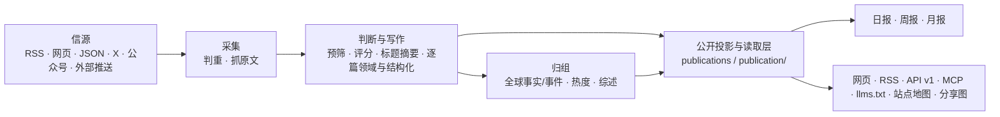

# 架构



## 三个进程

| 进程 | 位置 | 做什么 |
|---|---|---|
| api | `apps/api/` | Fastify。网站自用接口（`/api/site/`）、公开 API（`/api/v1/`）、RSS、MCP、后台接口、图片代理、分享图 |
| worker | `apps/worker/` | pg-boss 任务队列和定时任务：抓信源、调模型、归组、热度、日报、告警、清理 |
| web | `apps/web/` | React Router 服务端渲染的网页。只通过 HTTP 读 api，不碰数据库 |

业务代码都在 `packages/backend/`，前后端共用的类型和常量在 `packages/contracts/`，行业相关的一切在 `industry/`。

## 几条不变的规则

- **一个公开读取层**：网页、RSS、API、MCP、站点地图、分享图读的都是 `packages/backend/src/publication/`，所以各个出口看到的内容一致。新增公开出口也从这里读。
- **页面不调模型**：读者打开页面只读数据库里已经有的结果；模型只在 worker 的任务里调用。
- **花钱的请求有回执**：每个付费请求（模型、X、公众号、Jina）先记一张回执，拿到结果先存再用。进程重启、任务重试时复用已有结果。HTTP 层确认尚未交给网络的失败保留为 `not_sent` 尝试，释放预算占位，回执可正常重试；交给网络后结果丢失的请求记为 `unknown`，调用者不直接重发。`ops.recover` 在 30 分钟后自动释放一次；若之后仍未知，再由管理员核对供应商账单并处理。
- **预算熔断**：每个付费服务有每分钟、每小时、每天的上限，超过就暂停（后台“设置 → 预算”）。
- **安全阀**：`COLLECT_ENABLED`、`MODEL_CALLS_ENABLED`、`FEISHU_CONTENT_PUSH_ENABLED`、`FEISHU_INTERNAL_ENABLED`、`INDEXNOW_SUBMIT_ENABLED` 只决定“发不发出去”，不决定走哪套逻辑。开发与测试的隔离约束见 [AGENTS.md](../AGENTS.md#工程边界)。
- **公开内容匿名**：管理员和访客看到的一样；读者的收藏、已读存在浏览器里。后台只允许管理员。
- **旧文不刷屏**：发现时已发布超过 48 小时的资料、新信源的存量、回灌的推送，按原文时间归档，不进“今天”、不推送。
- **来源可追溯**：每条精选都链接原文；站内是否显示全文由信源的 `site_fulltext` 决定，默认只显示摘要。

## 领域、身份与公开投影

- 领域名称和 key 只由 [`industry/taxonomy.ts`](../industry/taxonomy.ts) 定义；领域与类别是独立维度。`all` 只表示概览或报告 scope，不是文章领域。
- URL 去重、文章 ID 与 `article@revision` 全局共享；事实和故事也保持全局身份，不按领域复制。文章的 `domains[]` 由现有结构化步骤根据该文章内容产出，分析绑定 `input_revision`。后台 override 可显式设置 `domains`（包括 `[]`）；清除 override 后回到分析结果。信源的 `domains` 只是覆盖范围和分析上下文，不作为文章归属回退值。
- `publications` 是唯一公开内容投影；网站、RSS、公开 API、MCP、站点地图等均经 `packages/backend/src/publication/` 读取。文章域筛选、SQL、计数、limit、cursor 和缓存都按同一查询 scope 处理。事实/故事的领域集合由当前公开投影中的成员派生，不改变其全局 ID。
- 精选同步的 snapshot 和 changes 始终是全局完整流，不按领域裁剪。每种 `upsert` 都带文章的完整 `domains` 集合，客户端每次收到 upsert 都要更新该文章的各领域成员关系；`remove` 代表全局撤回，不是单个领域移除。完整 v1 合同以[机器可读 OpenAPI 源规范](../reference/public-v1.openapi.json)和运行时 `/openapi-v1.json` 为准，其他文档不复制 schema 或枚举。
- 热度按全球唯一信源参与者计算一次。排行快照保存所有全局达标候选；领域视图先筛该域公开成员，再选代表并取 Top 10，不在领域内重算热度。
- 报告身份是 `(kind, scope, key)`：`kind` 为日报、周报或月报，scope 为概览 `all` 或当前五个领域之一，各组合独立成刊。它们共用同一 composer 和模型配置；每次模型实际输入及回执 subject 都包含 kind、scope、key。没有合格候选时仍保存空报告，不发起模型请求。每个 scope 独立按日报每天 08:00、周报周一 10:00、月报每月 1 日 10:30 调度，并由同一按 scope 补报流程追赶缺期；候选先按领域筛选，再选事实代表。
- Web 最新报告路径为 `/:kind`（概览）和 `/:kind/:domain`（领域）；日期详情为 `/:kind/:scope/:key`。日报归档为 `/daily/archive` 和 `/daily/:domain/archive`；网站当前不提供旧式 `/:kind/:date` 日期详情路径。V1 日报日期路径是 `/api/v1/dailies/:date?domain=...`，省略 domain 表示 `all`。MCP 保留五个现有 `myhot_` 工具，工具中的 domain 都可省略，省略表示概览；API 的完整公开合同见 `/openapi-v1.json`。
- Web 和后台复用同一个 `ThemeSwitch`；后台信源覆盖范围筛选与文章领域 override 使用 taxonomy 的同一领域词表，不能各自维护一套。

## Web 领域导航

- 精选首页用 `/?domain=:domain`，动态用 `/all/:domain`，热点、事件与主题用查询参数 `domain`。精选列表与首页热点条按同一主领域读取。省略领域的内容入口是实际概览；本地偏好不会过滤或重定向这些入口。报告路径沿用上面的范围身份。
- 桌面侧栏与移动页头复用一个 `DomainSwitcher`，不在各页面重复领域栏。公共主标题保持固定，领域作为导航上下文；精选与动态的子栏目来自 taxonomy 的展示预设，组合现有单值 `category`、`tag`、`channel` 筛选。配置方法见[定制说明](customize.md)。
- URL 中的范围优先。只有显式切换才保存浏览器偏好；没有显式范围的全局对象和说明页用偏好生成导航目标。站内页面链接携带范围上下文，但文章、模型榜和监控等全局数据不因此复制或过滤，canonical 保持对象自身身份。存储不可用时仍按 URL 正常导航。
- 换领域保留页面家族、搜索词与排序，只清理目标子栏目不支持的次级筛选并重置分页。事件和主题继续打开当前对象，报告详情转到同类最新一期，归档保留归档角色。重选当前领域不导航，不改变筛选、页码、锚点或报告期数。
- 临时不可用留在原 URL，由共用错误边界显示重试；重试重新执行当前页面的 loader，不跳转到独立错误页，也不丢失领域与查询参数。

## 目录

| 位置 | 内容 |
|---|---|
| `industry/` | 行业包：站名文案、分类标签、主题、示范信源、提示词、门槛、品牌、条款页 |
| `packages/backend/src/sources/` | 六种信源的读取器，抓取调度（`collect.ts`） |
| `packages/backend/src/content/` | 资料入库、判重、正文提取和清洗 |
| `packages/backend/src/editorial/` | 判断与写作：`analyze.ts`（流程）、`prompts.ts`（读提示词）、`models.ts`（每一步用哪个模型） |
| `packages/backend/src/events/` | 事件归组、热度、事件综述 |
| `packages/backend/src/publication/` | 公开读取层 |
| `packages/backend/src/reports/` | 日报、周报、月报 |
| `packages/backend/src/providers/` | 模型、向量、X、公众号、Jina 的调用，回执与预算 |
| `packages/backend/src/notify/` | 飞书推送 |
| `packages/backend/src/operations/` | 告警、备份、清理、IndexNow |
| `packages/backend/src/admin/` | 后台接口 |
| `packages/backend/src/leaderboard/`、`monitor/` | 模型榜、Codex 重置监控（见 [模型榜与 Codex 重置监控](leaderboard.md)） |
| `apps/web/app/routes/` | 每个页面一个文件，`routes.ts` 是路由表 |
| `database/migrations/` | 完整初始基线和编号增量迁移，由 `scripts/migrate.ts` 执行 |
| `scripts/` | 初始化、迁移、种子数据、评测、检查脚本 |
| `tests/` | 后端测试（需要一个名字以 `_test` 或 `_ci` 结尾的空库） |

## 对外出口

| 地址 | 内容 |
|---|---|
| `/` `/all` `/all/:domain` `/hot` `/topics` | 概览、全部动态及领域视图、全球热榜、主题 |
| `/daily` `/weekly` `/monthly` | 最新概览报告；最新领域报告使用 `/:kind/:domain` |
| `/:kind/:scope/:key` | 日期/周期报告详情，`scope` 为 `all` 或一个领域 |
| `/daily/archive` `/daily/:domain/archive` | 概览日报和领域日报归档 |
| `/feed.xml` `/feed/all.xml` `/feed/full.xml` `/feed/daily.xml` | RSS：精选、全部、全文、日报；日报 feed 可按领域 scope |
| `/api/v1/` | 公开 API，完整合同见 [`reference/public-v1.openapi.json`](../reference/public-v1.openapi.json)；站点运行时提供 `/openapi-v1.json`，说明页在 `/agent` |
| `/api/mcp` | MCP 服务，保留五个现有 `myhot_` 工具 |
| `/llms.txt` `/sitemap.xml` `/robots.txt` | 给大模型和搜索引擎的说明 |
| `/admin` | 后台 |

## 测试

```bash
npm run typecheck
createdb myhot_test
DATABASE_URL=postgres://127.0.0.1:5432/myhot_test node scripts/migrate.ts
DATABASE_URL=postgres://127.0.0.1:5432/myhot_test npm test
npm run build -w @aihot/web && node --test apps/web/tests/*.test.ts
```

测试不访问任何外部服务：模型和付费接口都由本地假服务回答。
